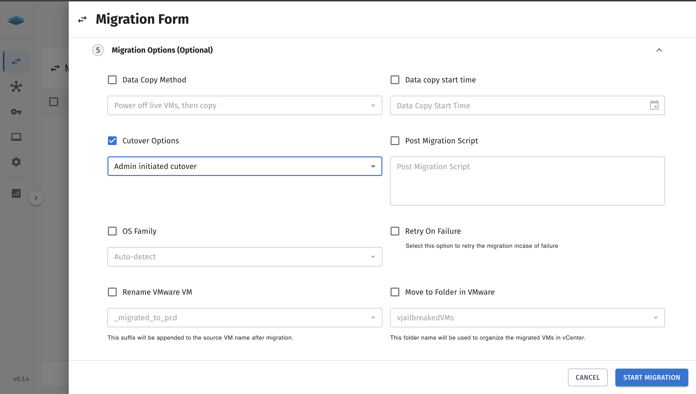
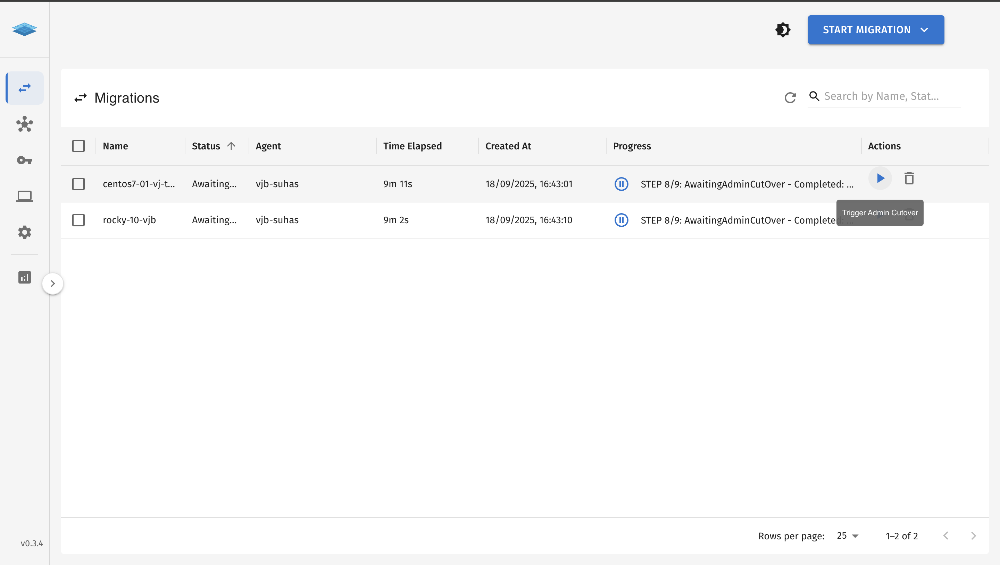
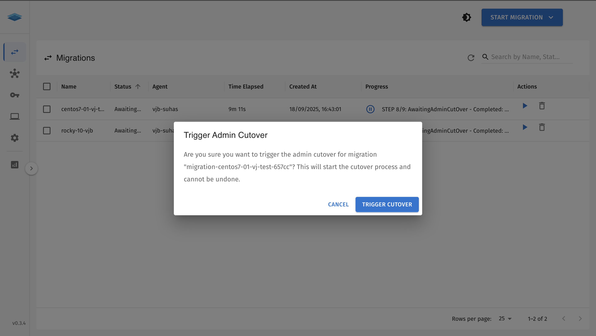
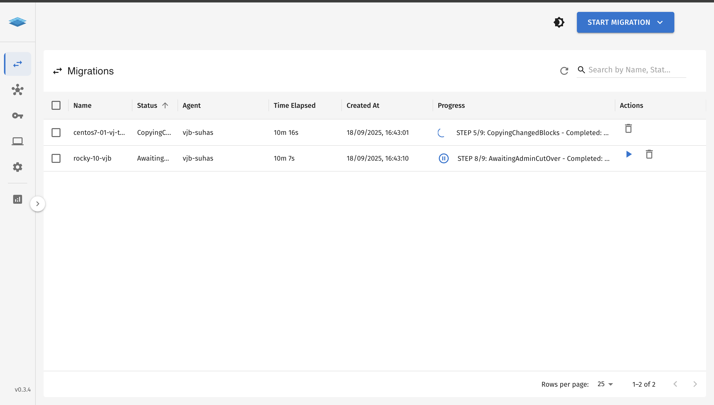

The **Admin Cutover** feature in vJailbreak is used to finalize a migration after the data transfer is complete.  
It can be triggered in two ways:
1. From the **vJailbreak UI**
2. Using **kubectl patch** on the corresponding `Pod` of the migration.


## Admin Cutover from the UI
1. When you create the migration, go to **Migration Options** → **Cutover** in the migration form. Select **Cutover option** and choose **Admin initiated cutover**, as shown in the image below.

   

   Once the migration is done copying data, its status changes to `AwaitingAdminCutOver`.
   You can then click the **Trigger Admin Cutover** button on the migration to start the cutover. To cut over several migrations at once, select them in the **Migrations** table and click **Trigger Cutover**.

   

2. A **Trigger Admin Cutover** confirmation dialog appears. Click **Trigger Cutover** to proceed with the admin cutover.

   

3. After you confirm, the migration starts the cutover process.

   


## Admin Cutover using kubectl patch
You can also trigger the admin cutover using the `kubectl patch` command.
1. First, identify the name of the migration `Pod` you want to perform the admin
   cutover for:
    * Get the name of the Migration object. You can find it in the vJailbreak UI under the migration details.
      ```bash
      kubectl get migration -n migration-system | grep -i <migration-name>
      migration-name   AwaitingAdminCutOver   vjb   migration-plan-name   1h
      ```
    * Get the podRef of the Migration object.
      ```bash
      kubectl get migration <migration-name> -n migration-system -o jsonpath='{.spec.podRef}'
      <pod-name>
      ```

2. Once you have identified the migration `Pod`, you can trigger the admin cutover by
   executing the following command:
   ```bash
   kubectl patch pod <pod-name> -n migration-system -p '{"metadata":{"labels":{"startCutover":"yes"}}}'
   ```
   Replace `<pod-name>` with the name of your migration `Pod` and `migration-system` with the name of your migration namespace.
