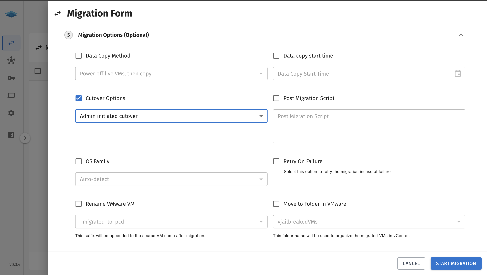
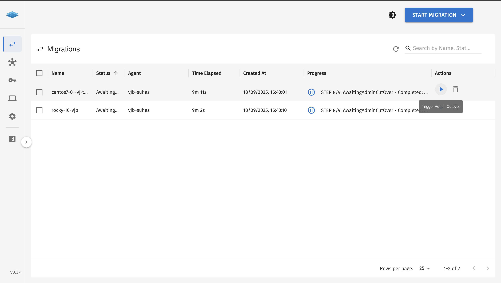
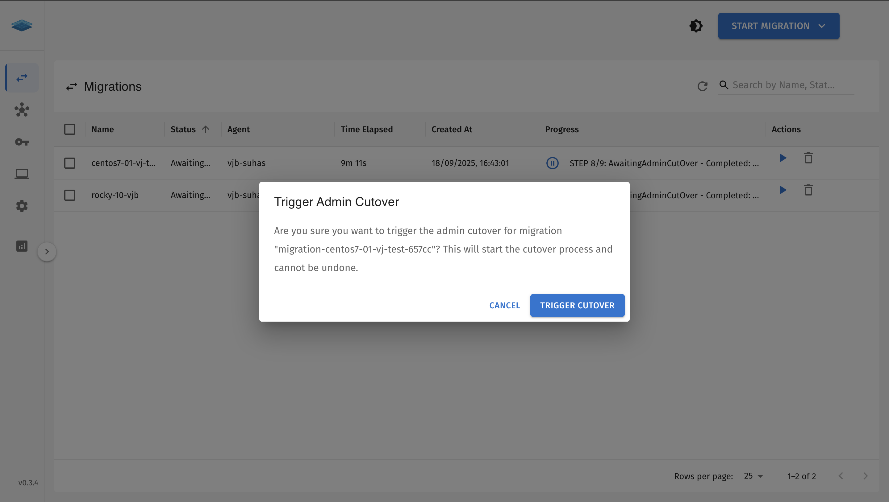
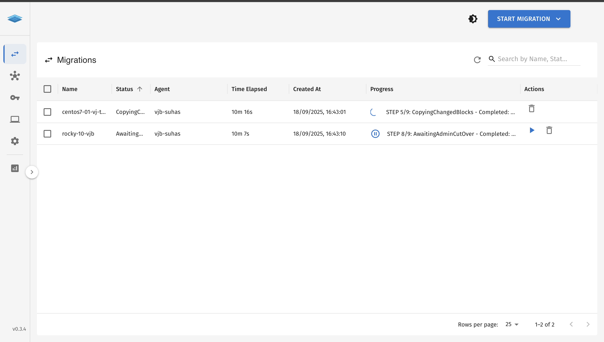

The **Admin Cutover** feature in vJailbreak is used to finalize a migration after the data transfer is complete.  
It can be triggered in two ways:
1. From the **vJailbreak UI**
2. Using **kubectl patch** on the corresponding `Pod` of the migration.


## Admin Cutover from the UI
1. When you create the migration, go to **Migration Options (Optional)** → **Cutover** in the migration form. Select the **Cutover option** checkbox, then choose **Admin initiated cutover** from the drop-down list, as shown in the image below. Cutover options are disabled when the data copy method is **Power off live VMs, then copy**; in that case, cutover happens automatically after the data copy.

   

   Once the migration is done copying data, its status changes to **Awaiting Admin Cutover** (`AwaitingAdminCutOver`).
   You can then click the **Trigger Admin Cutover** icon (▶) in the migration's **Actions** column, or on the migration's details page, to start the cutover. To cut over several migrations at once, select them in the **Migrations** table and click **Trigger Cutover (n)**.

   

2. A confirmation dialog appears: **Trigger Admin Cutover** for a single migration, or **Confirm Admin Cutover** for several. Click **Trigger Cutover** to proceed with the admin cutover.

   

3. After you confirm, the migration starts the cutover process.

   


## Admin Cutover using kubectl patch
You can also trigger the admin cutover using the `kubectl patch` command.
1. First, identify the name of the migration `Pod` you want to perform the admin
   cutover for:
    * Get the name of the Migration object. It has the form `migration-<vm-name>-<hash>`, where `<vm-name>` is the VM name in lowercase, with spaces and underscores replaced by hyphens and other special characters removed, and `<hash>` is a 5-character suffix. Search for it by that form of the VM name:
      ```bash
      kubectl get migration -n migration-system | grep -i <vm-name>
      migration-name   AwaitingAdminCutOver   vjb   migration-plan-name   1h
      ```
    * Get the podRef of the Migration object.
      ```bash
      kubectl get migration <migration-name> -n migration-system -o jsonpath='{.spec.podRef}'
      <pod-name>
      ```

2. Once you have identified the migration `Pod`, you can trigger the admin cutover by
   executing the following command:
   ```bash
   kubectl patch pod <pod-name> -n migration-system -p '{"metadata":{"labels":{"startCutover":"yes"}}}'
   ```
   Replace `<pod-name>` with the name of your migration `Pod` and `migration-system` with the name of your migration namespace.
